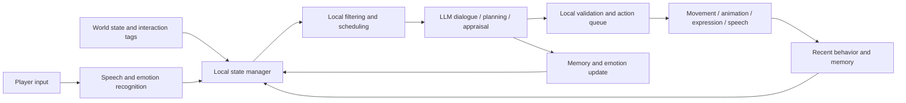

# LLM NPC Prototype

LLMとローカル状態管理を組み合わせ、レストラン内で接客・自律行動・記憶・感情表現を行うNPCを実装するためのUnreal Engine研究プロトタイプです。

本プロジェクトでは、NPCのすべての判断をLLMに任せるのではなく、頻繁な状態更新、行動候補の制限、確率判定、経路移動、アニメーション実行をローカルシステムで処理します。LLMは、会話生成、状況の意味理解、複数段階の計画生成、記憶の評価などに使用します。

> 現在は修士研究のための開発・検証用プロトタイプです。完成したゲーム製品ではありません。

## Research Goal

プレイヤーから入力がない時間にも、NPCが現在の環境、内部状態、過去の記憶に基づいて行動し、同じ作業であっても感情に応じて異なる表現を見せる仕組みを検討しています。

特に、次の二層を分離して扱います。

- **計画行動**: 水やり、テーブルの片付け、物品確認など、達成すべき作業の流れ
- **表現行動**: 表情、視線、驚き、小さな身振りなど、感情や状況に応じて重ねる表現

例えば、NPCが肯定的な記憶を想起して機嫌が良い場合、テーブルを片付ける計画を続けながら、明るい表情や軽い身体表現を追加できます。

## Current Features

### 接客フロー

- プレイヤーの入店検出と迎え
- 食事意思の確認
- テーブルへの案内
- 着席、メニュー表示、注文
- 料理の運搬と提供
- 離席後の食事完了確認
- 食器の回収と片付け

### 自律行動と計画

- 退屈度、タスク圧力、エネルギー、現在位置、環境状態のローカル更新
- 実行可能な行動候補のローカル絞り込み
- LLMによる複数段階の行動計画生成
- 計画の中断、接客優先、接客終了後の再開
- 水やり、テーブル清掃、物品確認、待機、スマートフォン操作などの行動
- 行動対象に応じた移動、アニメーション、手持ち小物の表示

### 記憶と感情

- プレイヤーとの会話や出来事からエピソード記憶を生成
- 重要度、感情価、覚醒度、環境手掛かり、経過時間による記憶候補の評価
- 注意に余裕がある場合の自発的な記憶想起
- LLMによる想起内容の意味評価
- 短期感情、覚醒度、長期的な気分の更新と時間減衰
- 感情状態を自律行動候補と身体表現へ反映

### 会話と身体反応

- 現在の行動、感情、最近の記憶、接客状態を会話コンテキストへ追加
- NPCからプレイヤーへの状況依存の自発的な話しかけ
- 集中度、発話の突然性、プレイヤーの方向から驚き確率を計算
- 驚きが発生した場合、その事実をLLMへ渡して台詞と身体反応を変化
- 自動まばたきと複数の表情意図

### 音声処理

- ローカルWhisperサービスによる音声認識
- ローカル感情認識サービスによるプレイヤー音声感情の推定
- OpenAI APIによる会話、計画、記憶評価
- VOICEVOXまたはStyle-Bert-VITS2による日本語音声合成

### 研究用ログ

- 計画生成、行動開始・終了、記憶生成、感情変化などのイベント記録
- 実験時のNPC内部状態と行動過程を追跡するための構造化ログ

## System Architecture



| 処理 | ローカルシステム | LLM |
| --- | --- | --- |
| 状態管理 | 退屈度、タスク圧力、エネルギー、時間減衰 | 状態の意味解釈 |
| 行動選択 | 実行不可能な候補の除外、優先制御 | 複数段階の計画生成 |
| 記憶 | 保存、検索候補、想起確率の計算 | 記憶内容の評価と解釈 |
| 感情 | 数値更新、減衰、表現条件への変換 | 会話や記憶による変化量の生成 |
| 実行 | 移動、アニメーション、オブジェクト操作 | 台詞と行動方針の生成 |

## Requirements

- Windows 10または11
- Unreal Engine **5.7**
- Visual Studio 2022とC++ゲーム開発ワークロード
- Git LFS
- OpenAI API key
- VRM4Uプラグイン（本リポジトリの`Plugins/VRM4U`に含まれています）

完全な音声機能を使用する場合は、次のローカルサービスも必要です。

| サービス | 既定URL | 用途 |
| --- | --- | --- |
| Whisper FastAPI | `http://127.0.0.1:8001` | 音声認識 |
| Emotion FastAPI | `http://127.0.0.1:8002` | 音声感情認識 |
| VOICEVOX | `http://127.0.0.1:50021` | 音声合成 |
| Style-Bert-VITS2 | `http://127.0.0.1:5000` | 代替音声合成 |

モデルファイル、Python仮想環境、VOICEVOX本体、Style-Bert-VITS2本体は、容量とライセンス上の理由からGit管理の対象外です。

## Setup

### 1. Clone

```powershell
git lfs install
git clone https://github.com/Zephyr319/LLMNPCPrototype.git
cd LLMNPCPrototype
git lfs pull
```

### 2. OpenAI API key

API keyはソースコードや設定ファイルへ直接記述せず、Windowsの環境変数`OPENAI_API_KEY`として設定してください。

```powershell
setx OPENAI_API_KEY "your-api-key"
```

設定後、Unreal Editorを再起動してください。現在の実装では`gpt-4o-mini`を既定モデルとして使用しています。

### 3. Optional local services

各ローカルサービスとPython環境を用意した後、必要に応じて次のスクリプトを起動します。

```text
StartWhisperService.cmd
StartEmotionService.cmd
StartTTSService.cmd
```

VOICEVOXを使用する場合は、VOICEVOX Engineをポート`50021`で起動してください。

### 4. Launch the project

1. `LLMNPCPrototype.uproject`をUnreal Engine 5.7で開きます。
2. C++モジュールの再ビルドを求められた場合は実行します。
3. `/Game/RestaurantDemo/Maps/Map_RestaurantDemo`を開きます。
4. Play In Editorで実行します。

## Main Components

| Component | Responsibility |
| --- | --- |
| `CafeServiceManagerActor` | 接客フローとプレイヤー状態の管理 |
| `NPCAutonomyComponent` | 自律状態、計画要求、行動キュー、表現の統合 |
| `NPCMemoryComponent` | エピソード記憶の保存と検索 |
| `NPCEmotionComponent` | 感情価、覚醒度、気分と時間減衰 |
| `NPCActionQueueComponent` | 複数段階行動の順次実行 |
| `NPCResearchLoggerComponent` | 研究・評価用イベントログ |
| `LLMClient` | OpenAI API、会話、計画、記憶評価 |
| `STTClient` / `EmotionClient` | ローカル音声サービスとの通信 |
| `VoicevoxTTSClient` / `TTSClient` | 日本語音声合成と再生 |

## Repository Notes

- `.uasset`、`.umap`、`.fbx`、`.mb`はGit LFSで管理しています。
- クローン後に素材が不足している場合は、`git lfs pull`を実行してください。
- `Binaries`、`Intermediate`、`Saved`、`DerivedDataCache`などの生成物は管理対象外です。
- API keyやローカルモデルをコミットしないでください。

## Current Limitations

- 実行可能な日常行動とアニメーションの種類はまだ限定的です。
- 一部の身体表現は既存アニメーションによる代替表現です。
- 鼻歌など、計画行動と同時に再生する音声表現は今後追加予定です。
- 現在の各閾値と確率はプロトタイプ検証用の初期値であり、ユーザ実験に基づく調整が必要です。
- VR版は将来計画であり、現在はデスクトップ版を中心に開発しています。

## Assets and Copyright

本リポジトリには、研究プロトタイプの検証を目的として、複数の外部提供元から取得したキャラクター、アニメーション、3Dモデルが含まれる場合があります。各素材の著作権と利用条件は、それぞれの権利者および配布元に帰属します。

本リポジトリを公開、複製、配布、商用利用する前に、すべての第三者素材のライセンスを個別に確認し、必要に応じて自作または正式購入した素材へ置き換えてください。

## Status

Active research prototype. The implementation and documentation will continue to change during development and evaluation.
